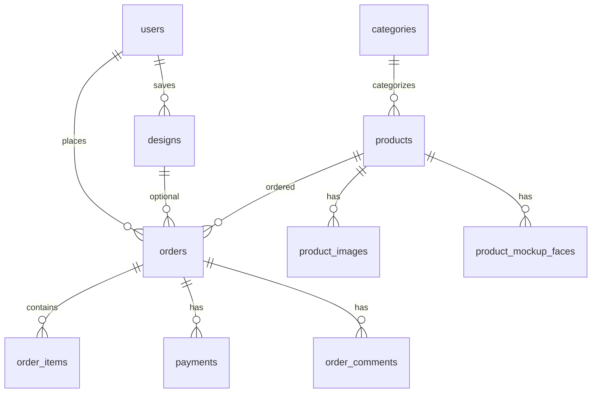

# 테이블 정의서 — 대지나염 (JHproject)

| 항목 | 내용 |
|------|------|
| 시스템명 | 대지나염 커스텀·기성품 쇼핑몰 |
| DBMS | MySQL |
| ORM / 기준 스키마 | Prisma (`prisma/schema.prisma`) |
| 작성 기준일 | 2026-11-09 |
| 테이블 수 | 30 (물리 테이블) |
| 비고 | 본 문서와 DB 불일치 시 **schema.prisma 우선** |

---

## 1. 문서 개요

### 1.1 목적

운영·개발·외주·검수 시 데이터 구조를 공통 기준으로 이해하고, 마이그레이션·연동·보안 검토에 활용한다.

### 1.2 도메인 구분

| 도메인 | 테이블(물리명) |
|--------|----------------|
| 회원·인증 | users, email_verification_tokens, password_reset_tokens, addresses |
| 포인트·쿠폰 | point_ledgers, coupons, coupon_claims |
| 장바구니·찜 | cart_items, wishlist_items |
| 카탈로그 | categories, products, product_images, product_mockup_faces, product_detail_sections, quantity_discount_rules, product_collections, product_collection_items, design_templates |
| 리뷰 | product_reviews |
| 콘텐츠·마케팅 | banners, site_popups, content_articles, site_settings |
| 디자인·주문 | designs, orders, order_items, order_comments, payments |
| CS | inquiries, return_requests |

### 1.3 ER 요약 (핵심 관계)

- **CUSTOM** 주문: `orders.design_id` → `designs` (빌더 시안 JSON)
- **READYMADE** 주문: `design_id` NULL 가능, `order_items` 다건 가능
- 회원 탈퇴: `users.deleted_at` (소프트 삭제)

---

## 2. Enum 정의

| No | Enum (Prisma) | 저장 형식 | 코드값 | 한글 설명 |
|----|---------------|-----------|--------|-----------|
| 1 | UserRole | MySQL ENUM | CUSTOMER | 일반 회원 |
| | | | ADMIN | 관리자 |
| 2 | OrderStatus | MySQL ENUM | PENDING | 접수 |
| | | | AWAITING_PAYMENT | 입금대기 |
| | | | CONFIRMED | 확인·제작 대기 |
| | | | IN_PRODUCTION | 제작 중 |
| | | | SHIPPED | 배송 중 |
| | | | DELIVERED | 배송 완료 |
| | | | CANCELLED | 취소 |
| 3 | PaymentStatus | MySQL ENUM | UNPAID | 미결제 |
| | | | PAID | 결제 완료 |
| | | | REFUNDED | 환불 |
| | | | FAILED | 결제 실패 |
| 4 | PaymentMethod | MySQL ENUM | CARD | 카드(PG) |
| | | | BANK_TRANSFER | 무통장입금 |
| | | | VIRTUAL_ACCOUNT | 가상계좌 |
| 5 | BannerPlacement | MySQL ENUM | HOME_HERO | 메인 히어로 |
| | | | HOME_PROMO | 메인 프로모 띠 |
| | | | HOME_IDEA | 홈 아이디어 |
| | | | HOME_GUIDE | 홈 가이드 |
| | | | HOME_CIRCLE | 홈 원형 네비 |
| 6 | CollectionType | MySQL ENUM | BEST, NEW, TRENDING, TEMPLATE, CUSTOM | 기획전 유형 |
| 7 | ProductSaleType | MySQL ENUM | CUSTOM | 커스텀(에디터) |
| | | | READYMADE | 기성품 |
| 8 | ProductDetailSectionType | MySQL ENUM | STORY, INFO, GUIDE, SIZE, FAQ, SHIPPING, CAUTION | 상세 하단 섹션 유형 |

---

## 3. 테이블 목록

| No | 논리명 | 물리명 | 설명 | PK |
|----|--------|--------|------|-----|
| 1 | 회원 | users | 로그인·역할·포인트 잔액 | id |
| 2 | 이메일 인증 토큰 | email_verification_tokens | 가입 인증 | id |
| 3 | 포인트 원장 | point_ledgers | 적립/사용 이력 | id |
| 4 | 사이트 설정 | site_settings | 사업자·계좌·배송비 JSON | id |
| 5 | 장바구니 | cart_items | 기성품 장바구니 | id |
| 6 | 찜 | wishlist_items | 상품 찜 | id |
| 7 | 비밀번호 재설정 | password_reset_tokens | 재설정 링크 | id |
| 8 | 쿠폰 | coupons | 쿠폰 마스터 | id |
| 9 | 쿠폰 발급·사용 | coupon_claims | 회원별 쿠폰 | id |
| 10 | 배송지 | addresses | 회원 배송지 | id |
| 11 | 카테고리 | categories | 상품 분류(트리) | id |
| 12 | 상품 | products | 판매 상품 | id |
| 13 | 상품 목업 면 | product_mockup_faces | 빌더 면별 이미지·인쇄영역 | id |
| 14 | 상품 상세 섹션 | product_detail_sections | 상세 하단 HTML 블록 | id |
| 15 | 상품 이미지 | product_images | 갤러리 | id |
| 16 | 기획전 | product_collections | 베스트/신상 등 | id |
| 17 | 기획전 상품 | product_collection_items | N:M 연결 | id |
| 18 | 수량 할인 | quantity_discount_rules | 대량 단가 구간 | id |
| 19 | 디자인 템플릿 | design_templates | 1분컷 시작 시안 | id |
| 20 | 상품 리뷰 | product_reviews | 구매 후기 | id |
| 21 | 배너 | banners | 메인 배너 | id |
| 22 | 사이트 팝업 | site_popups | 공지 팝업 | id |
| 23 | 콘텐츠 아티클 | content_articles | 가이드·아이디어 글 | id |
| 24 | 디자인(작업) | designs | 빌더 저장 시안 | id |
| 25 | 주문 | orders | 주문 헤더 | id |
| 26 | 반품·교환 | return_requests | CS 반품/교환 | id |
| 27 | 1:1 문의 | inquiries | 비회원·회원 문의 | id |
| 28 | 주문 품목 | order_items | 주문 라인(스냅샷) | id |
| 29 | 주문 코멘트 | order_comments | 작업 코멘트 | id |
| 30 | 결제 | payments | 결제·환불 이력 | id |

---

## 4. 테이블별 상세

> **공통 타입 (Prisma → MySQL)**  
> `String` → VARCHAR(191), `String @db.Text` → TEXT, `Int` → INT, `Float` → DOUBLE, `Boolean` → TINYINT(1), `DateTime` → DATETIME(3), `Json` → JSON, PK `String` → VARCHAR(191) + CUID

### 4.1 users (회원)

| No | 컬럼명 | 논리명 | 타입 | NULL | 기본값 | PK | UK | 설명 |
|----|--------|--------|------|------|--------|----|----|------|
| 1 | id | 회원 ID | VARCHAR(191) | N | cuid() | Y | | |
| 2 | email | 이메일 | VARCHAR(191) | N | | | Y | 로그인 ID |
| 3 | name | 이름 | VARCHAR(191) | N | | | | |
| 4 | phone | 전화번호 | VARCHAR(191) | Y | | | | |
| 5 | password_hash | 비밀번호 해시 | VARCHAR(191) | Y | | | | OAuth 전용 시 NULL |
| 6 | role | 역할 | ENUM(UserRole) | N | CUSTOMER | | | |
| 7 | email_verified_at | 이메일 인증 시각 | DATETIME(3) | Y | | | | |
| 8 | oauth_provider | OAuth 제공자 | VARCHAR(191) | Y | | | | kakao, google |
| 9 | oauth_id | OAuth 식별자 | VARCHAR(191) | Y | | | | |
| 10 | is_guest | 비회원 플래그 | TINYINT(1) | N | 0 | | | |
| 11 | points_balance | 포인트 잔액 | INT | N | 0 | | | |
| 12 | terms_agreed_at | 약관 동의 시각 | DATETIME(3) | Y | | | | |
| 13 | privacy_agreed_at | 개인정보 동의 시각 | DATETIME(3) | Y | | | | |
| 14 | deleted_at | 탈퇴 시각 | DATETIME(3) | Y | | | | 소프트 삭제 |
| 15 | created_at | 생성 시각 | DATETIME(3) | N | now() | | | |
| 16 | updated_at | 수정 시각 | DATETIME(3) | N | | | | |

**제약:** UK `(oauth_provider, oauth_id)` — OAuth 복합 유일

---

### 4.2 email_verification_tokens

| No | 컬럼명 | 타입 | NULL | PK/FK | 설명 |
|----|--------|------|------|-------|------|
| 1 | id | VARCHAR(191) | N | PK | |
| 2 | user_id | VARCHAR(191) | N | FK→users.id CASCADE | |
| 3 | token_hash | VARCHAR(191) | N | UK | 해시 저장 |
| 4 | expires_at | DATETIME(3) | N | | |
| 5 | used_at | DATETIME(3) | Y | | |
| 6 | created_at | DATETIME(3) | N | | |

**인덱스:** `(user_id, expires_at)`

---

### 4.3 point_ledgers

| No | 컬럼명 | 타입 | NULL | 설명 |
|----|--------|------|------|------|
| 1 | id | VARCHAR(191) | N | PK |
| 2 | user_id | VARCHAR(191) | N | FK→users CASCADE |
| 3 | type | VARCHAR(191) | N | EARN / SPEND / ADJUST |
| 4 | amount | INT | N | 변동량 |
| 5 | balance | INT | N | 변동 후 잔액 |
| 6 | reason | VARCHAR(191) | Y | |
| 7 | order_id | VARCHAR(191) | Y | 연관 주문 |
| 8 | created_at | DATETIME(3) | N | |

**인덱스:** `(user_id, created_at)`

---

### 4.4 site_settings

| No | 컬럼명 | 타입 | NULL | 설명 |
|----|--------|------|------|------|
| 1 | id | VARCHAR(191) | N | PK, 기본 `"default"` |
| 2 | data | JSON | N | 사업자·계좌·배송비 등 |
| 3 | updated_at | DATETIME(3) | N | |

---

### 4.5 cart_items

| No | 컬럼명 | 타입 | NULL | 설명 |
|----|--------|------|------|------|
| 1 | id | VARCHAR(191) | N | PK |
| 2 | user_id | VARCHAR(191) | N | FK→users CASCADE |
| 3 | product_id | VARCHAR(191) | N | FK→products CASCADE |
| 4 | quantity | INT | N | default 1 |
| 5 | created_at / updated_at | DATETIME(3) | N | |

**UK:** `(user_id, product_id)` · **인덱스:** `(user_id, updated_at)`

---

### 4.6 wishlist_items

| No | 컬럼명 | 타입 | NULL | 설명 |
|----|--------|------|------|------|
| 1 | id | VARCHAR(191) | N | PK |
| 2 | user_id | VARCHAR(191) | N | FK→users CASCADE |
| 3 | product_id | VARCHAR(191) | N | FK→products CASCADE |
| 4 | created_at | DATETIME(3) | N | |

**UK:** `(user_id, product_id)`

---

### 4.7 password_reset_tokens

`email_verification_tokens`와 동일 구조 (user_id, token_hash, expires_at, used_at).

---

### 4.8 coupons

| No | 컬럼명 | 논리명 | 타입 | NULL | 기본값 |
|----|--------|--------|------|------|--------|
| 1 | id | | VARCHAR(191) | N | PK |
| 2 | code | 쿠폰 코드 | VARCHAR(191) | N | UK |
| 3 | name | 쿠폰명 | VARCHAR(191) | N | |
| 4 | discount_type | PERCENT / FIXED | VARCHAR(191) | N | FIXED |
| 5 | discount_value | 할인값 | INT | N | |
| 6 | min_order_amount | 최소 주문액 | INT | N | 0 |
| 7 | max_discount | 최대 할인액 | INT | Y | |
| 8 | starts_at / ends_at | 유효 기간 | DATETIME(3) | Y | |
| 9 | usage_limit | 총 사용 한도 | INT | Y | |
| 10 | per_user_limit | 1인 한도 | INT | N | 1 |
| 11 | is_active | | TINYINT(1) | N | 1 |
| 12 | created_at / updated_at | | DATETIME(3) | N | |

---

### 4.9 coupon_claims

| 컬럼 | FK | 비고 |
|------|-----|------|
| coupon_id | coupons CASCADE | |
| user_id | users CASCADE | |
| used_at | | 사용 시각 |
| order_id | orders SET NULL | |

**UK:** `(coupon_id, user_id)`

---

### 4.10 addresses

| 컬럼 | 설명 |
|------|------|
| label | 배송지 별칭 (기본: "기본") |
| recipient_name, phone, zip_code, address1, address2 | 수령 정보 |
| is_default | 기본 배송지 |

**FK:** user_id → users CASCADE · **인덱스:** `(user_id, is_default)`

---

### 4.11 categories

| 컬럼 | 설명 |
|------|------|
| slug | UK, URL용 |
| parent_id | FK→categories (자기참조 트리) |
| sort_order, is_active | 노출 |

---

### 4.12 products

| No | 컬럼명 | 논리명 | 타입 | NULL | 설명 |
|----|--------|--------|------|------|------|
| 1 | id | | VARCHAR(191) | N | PK |
| 2 | category_id | 카테고리 | VARCHAR(191) | Y | FK→categories |
| 3 | slug | URL | VARCHAR(191) | N | UK |
| 4 | name | 상품명 | VARCHAR(191) | N | |
| 5 | short_desc | 한 줄 설명 | VARCHAR(191) | Y | |
| 6 | description | 상세 | TEXT | Y | |
| 7 | base_price | 기본단가(원) | INT | N | |
| 8 | min_quantity / max_quantity | 주문 수량 | INT | N | |
| 9 | thumbnail_url | 썸네일 | VARCHAR(191) | Y | |
| 10 | sale_type | CUSTOM / READYMADE | ENUM | N | |
| 11 | builder_type | ecobag 등 | VARCHAR(191) | N | |
| 12 | option_schema | 빌더 옵션 | JSON | Y | §부록 A |
| 13 | sort_order, is_active, is_featured, is_new | 노출 | | | |
| 14 | stock_quantity | 재고 | INT | Y | NULL=무제한 |
| 15 | notice_json | 고시 정보 | JSON | Y | |
| 16 | rating_avg / review_count | 리뷰 집계 | DOUBLE/INT | N | |

**인덱스:** `(category_id, is_active, sort_order)`, `(sale_type, is_active, sort_order)`

---

### 4.13 product_mockup_faces

면(side)별 목업 PNG, 인쇄영역 비율 `print_x`~`print_h` (0~1). **UK:** `(product_id, side)`

---

### 4.14 product_detail_sections

`type`(ProductDetailSectionType), `title`, `body`(TEXT), `image_url`, 정렬·노출.

---

### 4.15 product_images

상품 갤러리 URL, `is_primary`, `sort_order`.

---

### 4.16 product_collections / product_collection_items

기획전 마스터 + 상품 N:M. **UK:** `(collection_id, product_id)`

---

### 4.17 quantity_discount_rules

`min_quantity`, `unit_price`(우선) 또는 `discount_rate`, `label`.

---

### 4.18 design_templates

`builder_json`: 빌더 초기 상태 일부. product_id FK CASCADE.

---

### 4.19 product_reviews

`rating` 1~5, `is_visible`, `is_hot`, FK product/user, order_id optional SET NULL.

---

### 4.20 banners

`placement`(BannerPlacement), `link_url`, 정렬·노출. **인덱스:** `(placement, is_active, sort_order)`

---

### 4.21 site_popups

공지 팝업, `dismiss_hours`(다시 안 보기), 노출 기간.

---

### 4.22 content_articles

| JSON 필드 | 용도 |
|-----------|------|
| intro_json | 소개 문단 배열 |
| sections_json | 본문 섹션 배열 |
| faq_json | FAQ 배열 |

`type`: GUIDE | IDEA, `slug` UK.

---

### 4.23 designs

| 컬럼 | 설명 |
|------|------|
| user_id | FK users CASCADE |
| product_id | FK products optional |
| title | 작업명 |
| builder_json | 빌더 전체 상태 §부록 B |
| preview_url | 미리보기 이미지 |

---

### 4.24 orders

| No | 컬럼명 | 논리명 | 설명 |
|----|--------|--------|------|
| 1 | order_number | 주문번호 | UK |
| 2 | user_id | 회원 | FK→users |
| 3 | product_id | 대표 상품 | FK→products |
| 4 | design_id | 디자인 | FK→designs, 커스텀 시 |
| 5 | status | OrderStatus | |
| 6 | quantity | 수량 | |
| 7 | subtotal, discount_amount, coupon_discount, points_used | 금액 | 원 |
| 8 | coupon_claim_id | 사용 쿠폰 | (관계 coupon_claims) |
| 9 | shipping_fee, total_price | 배송·합계 | |
| 10 | notes | 요청사항 | |
| 11 | shipping_* | 배송 스냅샷 | name, phone, zip, address |
| 12 | payment_status, payment_method, paid_at | 결제 | |
| 13 | tracking_number, shipped_at, delivered_at | 배송 | MES 리드타임 shipped_at |

**인덱스:** `(user_id, created_at)`, `(status, created_at)`

---

### 4.25 return_requests

`type` EXCHANGE|RETURN, `status` PENDING|APPROVED|REJECTED|DONE, order/user FK CASCADE.

---

### 4.26 inquiries

회원 optional `user_id` SET NULL, `status` OPEN|ANSWERED|CLOSED, `admin_reply`.

---

### 4.27 order_items

주문 시점 `product_name`, `quantity`, `unit_price` 스냅샷. FK order CASCADE, product.

---

### 4.28 order_comments

작업 스레드 메시지. FK order/user CASCADE. **인덱스:** `(order_id, created_at)` — MES 재작업률(고객 코멘트) 집계에 사용.

---

### 4.29 payments

`method`, `status`, `amount`, `transaction_id`(PG), FK order CASCADE.

---

## 5. FK·삭제 정책 요약

| 자식 | 부모 | onDelete |
|------|------|----------|
| 대부분 회원 하위 | users | Cascade |
| 주문 코멘트·결제·품목 | orders | Cascade |
| 상품 하위(이미지·목업 등) | products | Cascade |
| coupon_claims.order | orders | SetNull |
| product_reviews.order | orders | SetNull |
| inquiries.user | users | SetNull |
| orders.user / product | users, products | Restrict(Prisma 기본) |

---

## 6. 부록

### A. products.option_schema (JSON)

빌더·상품 상세 옵션. 코드 타입: `ProductOptionSchema` (`src/lib/product-option-schema.ts`)

| 필드 | 타입 | 설명 |
|------|------|------|
| sizes | string[] | S, M, L, XL, 2XL, 3XL 등 |
| fabrics / colors / handles / … | string[] | 허용 옵션 키 목록 |
| shippingFee | number | 상품별 배송비(원) |

### B. designs.builder_json / 주문 저장 payload

빌더 상태: 옵션, 면별 Fabric 캔버스 JSON, 주석, 목업 오프셋 등. 타입: `SavedBuilderPayload`, `BuilderOptions` (`src/types/builder.ts`, `src/types/saved-design.ts`).

### C. site_settings.data (JSON)

브랜드명, 사업자정보, 계좌, 배송비, 연락처 등. 시드: `src/lib/site-info.ts`.

### D. 업무 규칙 (스키마 외)

- 커스텀 작업건: `orders.design_id IS NOT NULL` AND `status <> CANCELLED`
- 재작업률: 고객(`user_id`)이 남긴 `order_comments` 존재 비율
- 출하 리드타임: `created_at` → `shipped_at` (상태 SHIPPED/DELIVERED)

---

## 7. 변경 이력

| 일자 | 내용 | 작성 |
|------|------|------|
| 2026-11-09 | schema.prisma 전체 기준 초안 | — |

---

*문서 파일: `docs/테이블정의서.md` · 원본 스키마: `prisma/schema.prisma`*
